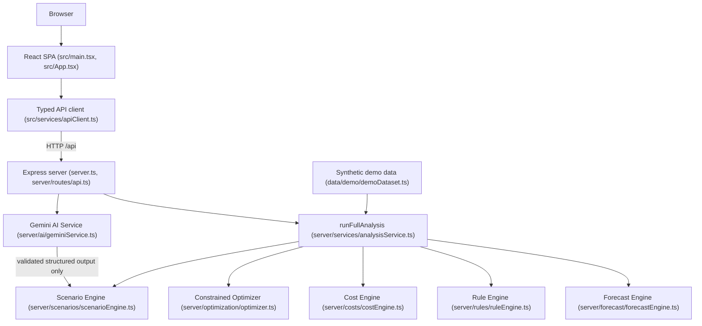

# CashShield — AI Cash-Crisis Decision Engine for Indian MSMEs  
  
> **"I don't have enough cash to pay everyone. What combination of actions should I take to minimize my estimated economic cost while keeping my business financially safe?"**  
  
CashShield is a full-stack decision-support application that answers that question for Indian Micro, Small, and Medium Enterprises (MSMEs). It combines daily cash-flow forecasting, rule-based eligibility checks, transparent cost modeling, illustrative financing comparison, and a deterministic bounded combinatorial optimizer into a single feasible action plan — with full formula traceability and What-If simulation.  
  
**Elevator pitch:** When an MSME faces a mid-month cash squeeze — payroll and statutory dues arriving before customer receivables — CashShield doesn't just show the problem. It computes a concrete, constraint-respecting action plan: which bills to pay, which to defer, which discounts to capture, which receivables to accelerate, and which financing facility to draw — all priced in rupees, all explainable, and all decided by deterministic code rather than an LLM.  
  
## At a Glance  
  
| Attribute | Detail |  
|---|---|  
| Project | CashShield |  
| Domain | MSME treasury / working-capital decision support (India) |  
| Target users | Indian MSME owners, finance teams, hackathon judges |  
| Core problem | Competing obligations vs. limited cash — what to pay, delay, accelerate, or finance |  
| Core solution | Forecast → rules → costs → constrained optimization → explainable action plan |  
| AI role | Natural-language What-If parsing, plan narration, document extraction, collection-message drafting (Google Gemini via `@google/genai`) |  
| Optimization role | Deterministic bounded combinatorial search (`server/optimization/optimizer.ts`) — **not** a global MILP solver |  
| Frontend | React 19 + TypeScript + Vite + Tailwind CSS v4 + Recharts + lucide-react + motion |  
| Backend | Node.js + Express 4 + TypeScript (run via `tsx`) |  
| Validation | Zod (shared schemas in `src/models/schemas.ts`) |  
| Data source | Built-in synthetic demo dataset (`data/demo/demoDataset.ts`) + CSV import + AI document extraction |  
| Runtime model | Single Express server on port 3000; Vite middleware in dev, static `dist/` in production |  
| Hackathon | Arthaton 2026 — "Build AI that handles money better" |  
  
---  
  
## 1. Problem Statement  
  
Small Indian businesses can have limited cash while supplier payments, payroll, receivables, deadlines, discounts, late costs, and financing options compete for liquidity. They need to decide **what to pay now, what can safely be delayed, which receivables are worth accelerating, and whether financing is economically justified.**  
  
A cash-flow dashboard is insufficient because it only *displays* the trajectory. It does not answer the decision question: given  
  
- available cash and a minimum operating reserve,  
- expected receivables and their dates,  
- supplier obligations with due dates,  
- early-payment discounts and their deadlines,  
- contractual late fees,  
- MSMED-related delayed-payment costs,  
- financing alternatives with rates, fees, and limits,  
- business constraints (protected payroll, critical suppliers),  
  
…which *combination* of actions minimizes estimated economic cost while keeping cash above the reserve every day?  
  
**The problem:** a cash shortage creates competing financial decisions with interacting costs and hard constraints.  
  
**What CashShield is not:** accounting software, a payment processor, a generic chatbot, a loan marketplace, tax-filing software, or a TReDS execution platform.  
  
---  
  
## 2. Proposed Solution — Pipeline  
  
The deterministic pipeline is orchestrated by `runFullAnalysis()` in `server/services/analysisService.ts`, which takes a `DatasetBundle` and produces an `AnalysisResult`.  
  
| Stage | Receives | Does | Produces | Implementation |  
|---|---|---|---|---|  
| Data ingestion | Demo dataset, CSV import, or AI-extracted document | Validates structure (Zod) and integrity (duplicate IDs, conflicting dates) | Validated `DatasetBundle` | `src/models/schemas.ts`, `server/routes/api.ts` (`validateDatasetIntegrity`), `src/utils/csvParser.ts` |  
| Normalization | `DatasetBundle` | Converts payables/receivables/payroll/transactions into dated `ScheduledCashFlow` events | `ScheduledCashFlow[]` | `buildBaselineFlowsFromDataset` in `server/forecast/forecastEngine.ts` |  
| Cash forecast | Flows + `BusinessProfile` | Day-by-day running balance over the planning horizon | `ForecastDay[]` | `generateDailyForecast` in `server/forecast/forecastEngine.ts` |  
| Shortfall detection | Forecast | Finds reserve breaches, trough, drivers | `ShortfallSummary` (`healthy`/`warning`/`crisis`) | `detectShortfall` in `server/forecast/forecastEngine.ts` |  
| Rule engine | Each payable/receivable | Evaluates MSMED, discount, late-fee, protection, financing-eligibility rules | `RuleApplicability[]` | `evaluatePayableRules`, `evaluateReceivableEligibility` in `server/rules/ruleEngine.ts` |  
| Cost engine | Payable/receivable + action + rules | Itemized rupee cost per candidate action with formula strings | `ActionCostEvaluation` | `calculatePayableActionCost`, `calculateReceivableAccelerationCost`, `calculateFinancingDrawdownCost` in `server/costs/costEngine.ts` |  
| Constraint builder / optimizer | All candidates | Bounded combinatorial search + exact credit-subset selection + greedy baseline | `baselinePlan`, `optimizedPlan` | `runConstrainedOptimizer` in `server/optimization/optimizer.ts` |  
| Validation | Chosen plan | Independent post-optimization constraint check | `ValidationCheckResult` | `validatePlanFeasibility` in `server/optimization/optimizer.ts` |  
| Recommendation API | Analysis result | REST endpoints | JSON `AnalysisResult` | `server/routes/api.ts` |  
| Explanation / AI layer | Completed analysis | Narrates results, parses What-If text, extracts documents, drafts reminders | Validated structured outputs | `server/ai/geminiService.ts` |  
| Web UI | API responses | Nine feature views | Interactive workspace | `src/App.tsx`, `src/features/*` |  
  
---  
  
## 3. Key Design Principle: AI + Deterministic Finance  
  
> **"AI proposes, extracts, and explains. Deterministic code calculates, validates, constrains, and decides."**  
  
CashShield deliberately does **not** let an LLM make financial decisions. Every rupee figure, date, eligibility verdict, and plan choice is produced by deterministic TypeScript. The AI layer is subordinate: it can translate a user's words into a *structured scenario patch*, but that patch is validated by Zod and then evaluated by the same deterministic engine — the AI never computes or alters a number itself.  
  
| Task | AI/LLM (Gemini) | Deterministic code |  
|---|---|---|  
| Interpret "what if my customer pays 10 days late?" | ✅ Parses into `ScenarioModification` | — |  
| Recompute the plan under that scenario | — | ✅ `runWhatIfScenario` |  
| Summarize a finished plan in plain language | ✅ `explainDeterministicPlan` (numbers supplied as JSON facts) | — |  
| Extract fields from an invoice/PO image or text | ✅ `extractInvoiceDocument` → human review | ✅ Zod validation of extracted fields |  
| Draft polite payment reminders | ✅ `generateCollectionMessages` (email/WhatsApp/Hinglish) | ✅ Template fallback when AI unavailable |  
| Cash forecasting, shortfall detection | — | ✅ `forecastEngine.ts` |  
| MSMED / discount / late-fee / protection rules | — | ✅ `ruleEngine.ts` |  
| All cost arithmetic | — | ✅ `costEngine.ts` |  
| Plan selection, feasibility, constraints | — | ✅ `optimizer.ts` |  
  
**Safety benefit:** even if the model hallucinates, its output must pass `ParsedWhatIfSchema` / `ExtractedDocumentSchema` / `CollectionMessagesSchema` validation, plus an explicit ID-existence check (`geminiService.ts` rejects AI-referenced IDs not present in the dataset). If `GEMINI_API_KEY` is missing, every AI function degrades gracefully (`aiAvailable: false`) and the deterministic engine is fully functional standalone.  
  
---  
  
## 4. System Architecture  
  


Everything inside the server/ engine boxes is deterministic. Only geminiService.ts calls an external LLM, and its outputs re-enter the system only through Zod-validated structures.

| Layer | Responsibility | Files |
|---|---|---|
| UI | Views, charts, modals, CSV import UI | src/App.tsx, src/features/*, src/components/* |
| API client | Typed fetch wrapper | src/services/apiClient.ts |
| HTTP server | Express app, Vite middleware / static serving | server.ts |
| REST routes | /api/health, /api/demo, /api/analyze, /api/scenario, /api/ai/* | server/routes/api.ts |
| Orchestration | Full analysis pipeline | server/services/analysisService.ts |
| Forecast | Daily cash projection, shortfall detection | server/forecast/forecastEngine.ts |
| Rules | MSMED, discount, late fee, protection, receivable eligibility | server/rules/ruleEngine.ts |
| Costs | Itemized cost components with formulas | server/costs/costEngine.ts |
| Optimization | Bounded search, greedy baseline, validation | server/optimization/optimizer.ts |
| Scenarios | What-If perturbation + before/after diff | server/scenarios/scenarioEngine.ts |
| AI | Gemini integration with Zod guards | server/ai/geminiService.ts |
| Schemas | Shared Zod models | src/models/schemas.ts |
| Demo data | Synthetic MSME dataset | data/demo/demoDataset.ts |

---

## 5. Data Model

All entities are Zod schemas in src/models/schemas.ts, shared between client and server.

| Entity | Purpose | Key fields |
|---|---|---|
| BusinessProfile | Operating parameters | currentCash, minimumCashReserve, protectedPayroll, payrollDueDate, analysisDate, planningHorizonDays, ruleConfig, criticalSupplierIds, mandatoryCategories |
| RuleConfig | Configurable statutory/policy parameters | msmedAnnualInterestRatePct, msmedRbiBankRateAssumptionPct, msmedMultiplier, msmedMaxWrittenAgreementDays, msmedDefaultNoAgreementDays, taxTimingEstimateEnabled |
| Payable | Supplier invoice | amount, invoiceDate, acceptanceDate, dueDate, supplierSize, mseEligibility, udyamRegistered, writtenAgreementPresent, agreementDays, discountPct, discountDeadline, contractualLateRatePct, criticalSupplier, mandatoryPayment, category, status |
| Receivable | Customer invoice | amount, dueDate, expectedPaymentDate, overdueDays, eligibleForFinancing, financingRatePct, financingDays, accelerationFeePct |
| CashTransaction | Historical or scheduled cash movement | date, transactionType, amount, category, isHistorical |
| FinancingOption | Credit facility | type (receivable_financing, working_capital_od, short_term_credit, promoter_bridge), availableAmount, annualRatePct, maxDurationDays, requiresEligibleReceivable, fixedFee, assumptions |
| PaymentTermRecord | Documented party terms | standardCreditDays, writtenAgreementPresent, earlyDiscountTerms, lateFeeClause, sourceDocument |
| DatasetBundle | Root container | all of the above |
| RuleApplicability | One rule verdict per payable | ruleId, status (eligible/not_eligible/unknown/available/expired/not_applicable), statutoryDeadlineDate, assumptions, explanation |
| ActionCostEvaluation | Cost of one candidate action | actionType, delayDays, executionDate, totalEstimatedCost, avoidedCostOrDiscountSavings, components[], assumptions[] |
| CostComponent | Single itemized cost line | type (msmed_interest, lost_discount, contractual_late_fee, financing_interest, financing_fixed_fee, acceleration_fee, tax_timing_estimate), amount, formula, inputs |
| ForecastDay / ShortfallSummary | Daily projection and crisis verdict | closingCash, shortfallAmount, isBelowReserve; status, peakShortfallAmount, firstShortfallDate, primaryDrivers |
| RecommendationItem | One action card | actionCode (PROTECT/PAY/CAPTURE_DISCOUNT/ACCELERATE/DELAY/FINANCE), whyDetails, mathBreakdown |
| PlanResult | A complete plan | feasible, totalEstimatedCost, minimumCashAfterPlan, recommendations, financingDrawdowns, validation |
| AnalysisResult | Full API response | unmitigatedForecast, shortfall, baselinePlan, optimizedPlan, comparison, payableRulesAudit, receivableAudit, solverMetadata |
| ScenarioModification | What-If patch | openingCashDelta, minimumReserveOverride, financingRateDeltaPct, financingRateOverridePct, financingUnavailable, receivableDelayAdjustments, payableDelayAdjustments |
| AI schemas | Strictly validated AI outputs | ParsedWhatIfSchema, ExtractedDocumentSchema (with superRefine date-consistency checks), CollectionMessagesSchema |

---

## 6. Demo Data

The built-in dataset (data/demo/demoDataset.ts) is entirely synthetic — isSyntheticDemo: true. It models Vardhman Precision Components Pvt. Ltd., a fictional automotive precision-machining MSME, with analysisDate: 2026-11-20 and a 30-day horizon.

| Item | Value |
|---|---|
| Opening cash | ₹4,00,000 |
| Minimum reserve | ₹1,00,000 |
| Protected payroll | ₹2,50,000 due 2026-11-28 |
| Payables | 12 invoices totaling ₹9,15,000 |
| Receivables | 10 invoices totaling ₹9,40,000 |
| Cash transactions | 32 (historical + scheduled) |
| Financing options | 4 illustrative facilities |
| Payment-term records | 5 |

The payables deliberately cover every rule branch: eligible MSE suppliers (PAY-001 Sharma Steel ₹2,40,000; PAY-004 Precision Tooling ₹85,000 — both also criticalSupplierIds), an unknown-Udyam supplier (PAY-008 Narmada Logistics), mandatory categories (PAY-005 MSEDCL utility, PAY-006 GST & TDS challan — categories Utilities & Rent and Statutory & Tax are in mandatoryCategories), an active 2% discount (PAY-002 Deccan Alloy, deadline 2026-11-24), an expired 1.5% discount (PAY-011 Western Lubricants, deadline 2026-11-15), and contractual late fees (10–18% p.a.).

Receivables include four financing-eligible anchor-buyer invoices (REC-001, REC-002, REC-005, REC-006) and overdue invoices ineligible for discounting (REC-003, REC-004, REC-007).

Financing options (all labeled illustrative demo inputs, not live quotes):

| ID | Facility | Available | Annual rate | Fixed fee |
|---|---|---|---|---|
| FIN-001 | Illustrative TReDS / Invoice Discounting | ₹4,50,000 | 9.5% | ₹500 |
| FIN-002 | Bank Working Capital OD | ₹2,75,000 | 12.5% | ₹1,000 |
| FIN-003 | Short-Term NBFC Credit Line | ₹2,50,000 | 16.0% | ₹1,500 |
| FIN-004 | Promoter Temporary Liquidity Buffer | ₹75,000 | 8.0% | ₹0 |

Synthetic data is ideal for a hackathon: it exercises every code path (crisis, rules, costs, optimization, scenarios) without exposing real financial data.

---

## 7. Cash Forecasting

Implemented in server/forecast/forecastEngine.ts:

- buildBaselineFlowsFromDataset emits dated flows: protected payroll, each pending payable on its plannedPaymentDate || dueDate (clamped to the analysis date if already due), each receivable on expectedPaymentDate, and non-historical cashTransactions inside the horizon.
- generateDailyForecast iterates planningHorizonDays days: closingCash = openingCash + inflows − outflows; shortfallAmount = max(0, minimumCashReserve − closingCash).
- detectShortfall returns crisis if any day breaches the reserve, warning if the trough is within 1.35× reserve, else healthy — plus peakShortfallAmount, firstShortfallDate, trough date, and the top-4 outflow drivers.

For the demo dataset, the test suite asserts status === 'crisis' with a positive peak shortfall — driven by the Nov 24–29 payable cluster (₹2,40,000 + ₹1,50,000 + ₹1,10,000 + ₹85,000 + ₹42,000 + payroll ₹2,50,000) landing before most receivables settle in December.

---

## 8. Rule Engine

evaluatePayableRules (server/rules/ruleEngine.ts) emits four rules per payable:

| Rule | Type | Logic |
|---|---|---|
| RULE_MSMED_DELAY | Statutory | eligible only when mseEligibility === 'eligible' and an acceptanceDate exists. Statutory deadline = acceptanceDate + min(agreementDays, 45) with a written agreement, or acceptanceDate + 16 (day after the 15-day no-agreement period) without one. Missing acceptance evidence → unknown (invoice date is explicitly not used as a proxy). Non-MSE → not_eligible. |
| RULE_EARLY_DISCOUNT | Contractual | available if discountDeadline >= analysisDate, else expired, else not_applicable. |
| RULE_CONTRACT_LATE_FEE | Contractual | available only when contractHasLateFeeClause and contractualLateRatePct > 0. |
| RULE_PROTECTED_OBLIGATION | Business policy | eligible when mandatoryPayment, category ∈ mandatoryCategories, criticalSupplier, or ID ∈ criticalSupplierIds. |

evaluateReceivableEligibility requires an active receivable_financing facility, overdueDays === 0, a recorded acceptanceDate, eligibleForFinancing === true, and amount within the facility cap.

Classification: MSMED deadline/interest = statutory; discount and late-fee = contractual; protected obligations, reserve, and facility terms = configured business policy; all demo values = synthetic assumptions.

---

## 9. Current Regulatory Basis

MSMED Act, Sections 15–16 (as modeled): payment period capped at 45 days with a written agreement; appointed day = day after 15 days from acceptance/deemed acceptance without one; delayed payment attracts compound interest with monthly rests at 3× the RBI Bank Rate.

Current demo configuration (ruleConfig in data/demo/demoDataset.ts):

| Parameter | Value |
|---|---|
| RBI Bank Rate snapshot | 5.75% |
| MSMED multiplier | 3× |
| Derived annual rate | 17.25% |
| Rule version label | MSMED Act Sec 15-16 · RBI Bank Rate snapshot 2026-11-20 |
| Effective configuration date | 2026-11-20 |

The rate is a configurable input, not a hard-coded legal constant — it must be updated when the RBI Bank Rate changes.

TReDS: modeled only as an illustrative receivable_financing facility (FIN-001). CashShield does not execute TReDS transactions or guarantee financing.

Tax: when MSMED interest is computed and taxTimingEstimateEnabled is on, the cost engine appends an informational note that for tax year 2026-27 onward the MSME payment-deduction rule is Section 37(2)(g) of the Income-tax Act, 2025 — explicitly stating CashShield does not quantify tax and gives no tax advice (costEngine.ts). taxTimingMarginalRatePct is 0 in the demo.

Referencing a regulation does not make the output legally compliant; all outputs are decision-support estimates.

---

## 10. Cost Engine

server/costs/costEngine.ts produces itemized CostComponents, each with a human-readable formula string and inputs.

| Component | Formula |
|---|---|
| msmed_interest | calculateMsmedCompoundInterest: compound at month anniversaries — P × (1 + r/12)^months — then pro-rate the remaining partial month on the compounded balance (balance × r × days/365). Verified: ₹1,00,000 at 17.25% for one month → ₹1,438 (test). |
| lost_discount | amount × discountPct when payment misses discountDeadline. |
| contractual_late_fee | amount × rate × delayDays / 365 (simple pro-rata). |
| financing_interest | drawn × annualRatePct × effectiveDays / 365. |
| financing_fixed_fee | Flat fixedFee per active facility. |
| acceleration_fee | receivableAmount × accelerationFeePct. |

Worked example (from tests): PAY-002 Deccan Alloy ₹1,50,000 with a 2% discount — capture_discount on 2026-11-24 yields totalEstimatedCost = 0 and avoidedCostOrDiscountSavings = ₹3,000; delaying to 2026-12-09 yields totalEstimatedCost = ₹3,000 as lost_discount. Receivable acceleration assumes T+2 settlement and uses the receivable's own financingRatePct/financingDays when present.

---

## 11. Optimization Engine

runConstrainedOptimizer (server/optimization/optimizer.ts) is a deterministic bounded combinatorial search — not a global MILP solver and not claimed as globally optimal.

Decision variables:

- Per payable: capture_discount (if window open), pay_on_time, or delay_payable at +7/+14/+21 days and at horizon end. Protected payables get no delay candidates.
- Per receivable: wait_expected or accelerate_receivable (only if eligible and acceleration actually pulls cash earlier).
- Credit: solveExactCreditDrawdown enumerates all subsets of non-receivable facilities (exact subset selection, cheapest-rate-first fill) to cover the peak deficit over the required bridge duration; repayment is always scheduled at recovery or horizon end — a loan is never silently dropped.

Procedure:

1. runGreedyBaseline — protects mandatory/critical payables, greedily delays discretionary payables by lowest cost-per-rupee-day, then greedily accelerates receivables. This is the benchmark and warm start.
2. Max-liquidity probe — if even maximum acceleration + maximum delay is infeasible, exit early as infeasible.
3. Two-pass coordinate descent warm start.
4. Bounded DFS with branch-and-bound pruning (MAX_NODES = 1500; prune when partial action cost exceeds incumbent).
5. Deterministic tie-breaking: lower cost → higher minimum cash → fewer delayed payables → fewer total delay days.
6. validatePlanFeasibility — an independent post-optimization validator re-checking: reserve on every day, payroll paid on date, protected payables not delayed, receivable eligibility + facility cap, drawdown limits/durations, no execution before invoice date. If the optimized plan fails validation but the baseline passes, it falls back to the baseline.

solverMetadata reports nodesEvaluated and executionMs. The test suite asserts the optimized plan is feasible, valid, protects PAY-001/PAY-005, and costs ≤ the greedy baseline on identical inputs.

---

## 12. Constraints and Safety

| Constraint | Type |
|---|---|
| Minimum cash reserve every horizon day | Hard (validated twice: in evaluateDecisionSet and validatePlanFeasibility) |
| Protected payroll on due date | Hard |
| Mandatory categories / critical suppliers never delayed | Hard (delay candidates never generated) |
| Receivable financing facility cap | Hard |
| Credit facility limits & max duration | Hard |
| No execution before invoice date | Hard |
| MSMED interest, late fees, lost discounts | Soft costs (priced, not forbidden) |
| unknown MSMED status | Informational flag — interest excluded from the sum, flagged for verification |

Infeasible scenarios return feasible: false with explicit infeasibilityReasons (e.g., "Remaining liquidity gap of ₹X over N days exceeds eligible credit facility limit of ₹Y") — verified by the no-financing test case.

---

## 13. What-If Scenario Engine

server/scenarios/scenarioEngine.ts supports these ScenarioModification controls (Zod-bounded):

- openingCashDelta — change opening cash
- minimumReserveOverride — change the reserve
- financingRateOverridePct / financingRateDeltaPct — set/shift all financing rates
- financingUnavailable — zero all facilities and receivable eligibility
- receivableDelayAdjustments — delay/advance a customer's expectedPaymentDate (−30…+60 days) or disableFinancing
- payableDelayAdjustments — supplier grace days (−15…+45), also shifting agreementDays

runWhatIfScenario runs runFullAnalysis on both baseline and modified datasets — it genuinely re-optimizes, then diffs minimum cash, shortfall, plan cost, financing drawn, and per-entity action changes, producing a summaryExplanation.

---

## 14. AI / Gemini Features

server/ai/geminiService.ts uses @google/genai with model gemini-4-hydrogen, ThinkingLevel.LOW, and responseSchema JSON-mode outputs:

| Function | Purpose | Guardrails |
|---|---|---|
| parseNaturalLanguageWhatIf | NL query → ParsedWhatIf | Zod validation + rejects IDs not in dataset; confident=false → clarification question |
| explainDeterministicPlan | Narrates a finished plan | Prompt restricts it to the supplied JSON facts; forbidden from inventing figures |
| extractInvoiceDocument | Invoice/PO text or image → ExtractedDocument | Zod + superRefine date checks; feeds a mandatory human review step |
| generateCollectionMessages | Email/WhatsApp/Hinglish reminders | Zod-validated; deterministic template fallback; no legal threats permitted |

If GEMINI_API_KEY is unset or the placeholder, getClient() returns null and every function returns aiAvailable: false with a graceful message. AI output can never become an unvalidated financial decision — it only ever produces a candidate patch or text.

---

## 15. Application Pages / User Workflow

Nine views, routed by activeTab in src/App.tsx:

### Landing (src/features/landing/LandingView.tsx)

Purpose: entry point and pitch. Sees: product identity, problem framing, demo entry. Does: loads the demo dataset + analysis (GET /api/demo) and enters the workspace. Screenshot: should show CashShield branding, the core question, and the demo CTA.

### Dashboard (src/features/dashboard/DashboardView.tsx)

Purpose: high-level KPIs. Sees: shortfall status, projected minimum cash, reserve breach dates, cash trajectory chart (CashFlowChart), financing capacity. Screenshot: crisis headline + cash curve dipping below the reserve line.

### Cash Crisis (src/features/crisis/CashCrisisView.tsx)

Purpose: the action plan. Sees: prioritized RecommendationItem cards (PROTECT/PAY/CAPTURE_DISCOUNT/ACCELERATE/DELAY/FINANCE), before/after cash, baseline-vs-optimized cost comparison, WhyModal and ShowMathDrawer per action. Screenshot: recommendation list with estimated costs and the post-plan cash floor at/above reserve.

### Payables (src/features/payables/PayablesView.tsx)

Purpose: payable ledger + rule audit. Sees: per-invoice MSMED status, statutory deadlines, discount windows, late fees, recommended actions. Screenshot: rule badges (eligible/unknown/expired) and due dates.

### Receivables (src/features/receivables/ReceivablesView.tsx)

Purpose: receivable ledger + acceleration eligibility. Sees: eligibility verdicts, financing rates, acceleration cost estimates; can trigger AI collection-message drafts. Screenshot: eligible vs. overdue-ineligible invoices.

### Cost Explorer (src/features/costs/CostExplorerView.tsx)

Purpose: compare candidate actions per payable. Sees: itemized CostComponents with formula strings. Screenshot: side-by-side cost of paying vs. delaying an invoice.

### What-If (src/features/scenarios/WhatIfView.tsx)

Purpose: scenario simulation. Does: structured controls and/or a natural-language box (POST /api/ai/parse-what-if → POST /api/scenario). Sees: before/after deltas and action changes. Screenshot: a scenario (e.g., customer pays 10 days late) with recomputed cost delta.

### Evidence (src/features/evidence/EvidenceView.tsx)

Purpose: audit trail. Sees: rule versions, configured rates, assumptions, source metadata. Screenshot: MSMED rule version + RBI rate snapshot + per-rule assumptions.

### Data Import (src/features/import/DataImportView.tsx)

Purpose: bring your own data. Does: CSV import via parseAndValidateCsv (src/utils/csvParser.ts) or AI document extraction (POST /api/ai/extract-document) into a human review step. Screenshot: CSV validation errors / extracted fields awaiting review.

Shared components: LayoutShell, CashFlowChart, ShowMathDrawer, WhyModal, DisclaimerBanner (src/components/).

---

## 16. Execution Guide

### Prerequisites

Node.js (v18+ recommended) and npm. No other services required; GEMINI_API_KEY is optional.

### Clone

```bash
git clone <YOUR_GITHUB_REPOSITORY_URL>
cd <REPOSITORY_FOLDER>
```

### Install

```bash
npm install
```

### Environment

```bash
cp .env.example .env
```

.env.example defines GEMINI_API_KEY (optional — AI features degrade gracefully without it) and APP_URL. PORT defaults to 3000. Never commit real keys.

### Test

```bash
npm test        # vitest run
```

Success: all tests in tests/cashshield.test.ts pass.

### Typecheck & build

```bash
npm run lint    # tsc --noEmit
npm run build   # vite build → dist/
```

### Run

```bash
npm run dev     # tsx server.ts → http://localhost:3000
```

In dev, Express mounts Vite middleware; in production (NODE_ENV=production, npm start) it serves dist/.

### Demo flow

Landing → load demo → 2. Dashboard (see the crisis) → 3. Cash Crisis (the plan) → 4. Payables → 5. Receivables → 6. Cost Explorer → 7. What-If → 8. Evidence → 9. Data Import.

---

## 17. Screenshot Guide

| Page | What to capture | Why it matters |
|---|---|---|
| Landing | Identity, problem statement, demo entry | First impression |
| Dashboard | Crisis status, reserve breach, cash trajectory | Proves forecasting works |
| Cash Crisis | Action plan + before/after cash + cost comparison | The core value |
| Payables | MSMED/discount/late-fee rule badges | Regulatory depth |
| Receivables | Eligibility + acceleration recommendations | Second liquidity lever |
| Cost Explorer | Itemized formulas per action | Transparency |
| What-If | Scenario → recomputed plan diff | Real re-optimization, not UI math |
| Evidence | Rule versions, rate snapshot, assumptions | Auditability |
| Data Import | CSV validation / AI extraction review | Real-data path |

---

## 18. End-to-End Example (Demo Dataset)

- Data: Vardhman opens 2026-11-20 with ₹4,00,000; reserve ₹1,00,000; payroll ₹2,50,000 on Nov 28; ₹9,15,000 payables clustered Nov 20–Dec 10; ₹9,40,000 receivables mostly settling Dec 2–18.
- Forecast: baseline flows produce a crisis — the Nov 24–29 outflow cluster breaches the reserve before December inflows arrive.
- Rules: PAY-001/PAY-004 are MSE-eligible and critical → protected; PAY-005/PAY-006 mandatory → protected; PAY-002's 2% discount is available; PAY-011's is expired; PAY-008 is unknown (no acceptance date, unverified Udyam).
- Costs: each candidate action is priced — e.g., delaying PAY-002 forfeits ₹3,000; MSMED-eligible delays accrue 17.25% monthly-rest interest from the statutory deadline.
- Optimize: bounded search picks the cheapest feasible mix — e.g., capture the ₹3,000 discount, pay protected items on time, defer the cheapest discretionary payables, accelerate eligible receivables (9.5–11% illustrative) and/or draw the cheapest credit subset to bridge the remaining trough.
- Validate: validatePlanFeasibility re-checks every constraint independently.
- Explain: each RecommendationItem carries whyDetails and a mathBreakdown; optionally Gemini narrates the plan using only the computed facts.
- What-If: the user can perturb assumptions and watch the whole pipeline re-run.

---

## 19. Technologies Used

| Layer | Technologies |
|---|---|
| Frontend | React 19, TypeScript, Vite 8, Tailwind CSS 4 (@tailwindcss/vite), Recharts, lucide-react, motion |
| Backend | Express 4, tsx, dotenv, date-fns |
| Validation | Zod 4 |
| AI | @google/genai (Gemini, model gemini-4-hydrogen) |
| Testing | Vitest 5 |
| Build/quality | Vite, tsc --noEmit |

---

## 20. Testing

tests/cashshield.test.ts (Vitest) contains 11 tests across 5 suites:

- Forecast & shortfall (3): demo crisis detection; exact-reserve boundary → warning not crisis; healthy profile → feasible plan with zero financing.
- Rules & costs (2): eligible/unknown/expired rule statuses; MSMED monthly-rest interest (₹1,438 verified), statutory deadline math (45-day → 2026-11-26; no-agreement → 2026-11-17), discount capture/loss, overdue-receivable ineligibility, OD cost formula.
- Optimizer & validator (2): feasible valid plan ≤ baseline cost with protected payables paid; clean infeasibility when financing is removed.
- What-If (1): customer delay worsens shortfall; 24% rate spike raises cost; −₹1,00,000 opening cash drops minimum cash by exactly ₹1,00,000.
- CSV/integrity/AI guards (3): missing columns, negative amounts, duplicate IDs, bad enums, BOM handling; conflicting-date integrity; Zod enforcement on ParsedWhatIfSchema, ExtractedDocumentSchema, CollectionMessagesSchema.

---

## 21. Limitations & Disclaimers

- Demo data is synthetic; financing rates/limits are illustrative assumptions, not quotes or offers.
- TReDS is modeled, not executed; no financing is guaranteed.
- The optimizer is a bounded search (MAX_NODES = 1500) — strong but not a global-optimality guarantee.
- MSMED logic is configurable decision support grounded in Sec 15–16; the RBI Bank Rate snapshot (5.75% → 17.25%) must be maintained.
- Tax references (Income-tax Act 2025 §37(2)(g)) are informational only; no tax liability is computed.
- AI text is not financial/legal authority; AI features degrade gracefully without a key.
- Outputs are estimates — verify material decisions with qualified professionals.

---

## 22. Hackathon Context — Arthaton 2026

Theme: "Build AI that handles money better." Online hackathon for college students across India; solo or teams up to 3; free entry; registration closed 15 Nov 2026; submission deadline 22 November 2026, 23:59 IST. Prizes: ₹10,000 / ₹5,000 / ₹3,000; certificates for all valid submissions. Relevant suggested direction: small-business finance — cash-flow forecasts and loan/EMI planning. Judging: real-world impact, theme relevance, end-to-end functionality, use of AI, creativity, originality, demo quality. Submission: public GitHub repo + README + demo video under 5 minutes.

---

## 23. Why CashShield Fits Arthaton

| Criterion | How CashShield fits |
|---|---|
| Real-world impact | MSME cash crunches and MSMED delayed-payment exposure are real, costly problems |
| Finance relevance | Directly the suggested small-business-finance direction |
| Use of AI | Gemini for NL What-If parsing, plan narration, document extraction, collection drafts — with strict validation |
| End-to-end functionality | Full stack: data → forecast → rules → costs → optimize → validate → explain → UI, plus tests |
| Creativity | Treats the crisis as a constrained decision problem, not a dashboard |
| Originality | Combines forecast + statutory rules + itemized costs + receivable acceleration + financing subsets + bounded search + AI narration |
| Demo quality | Self-contained synthetic dataset; runs with npm install && npm run dev; AI optional |

The AI/deterministic split is a strength: it shows AI used responsibly for money — proposing and explaining, never deciding.

---

## 24. Originality / Differentiation

CashShield's distinguishing design is the combination: forward forecast + statutory/contractual/business rules + itemized economic cost comparison + receivable acceleration + financing alternatives + payment timing + deterministic bounded optimization + AI explanation — in one auditable plan. A dashboard shows the problem; a reminder app chases one invoice; a loan calculator prices one facility. CashShield jointly decides across all levers under hard constraints, and every number carries a formula.

---

## 25. Complete End-to-End Workflow

1. Business data (demo / CSV / AI-extracted)
2. Zod + integrity validation
3. Baseline flows & daily forecast
4. detectShortfall → healthy / warning / crisis
5. Rule engine: MSMED, discounts, late fees, protections, eligibility
6. Cost engine: itemized rupee costs per action
7. Greedy baseline plan
8. Bounded combinatorial search + exact credit subsets
9. Independent constraint validation
10. RecommendationItems with Why + Show Math
11. Optional Gemini narration (facts only)
12. UI: Dashboard, Crisis plan, Payables, Receivables, Costs, Evidence
13. What-If → re-run full pipeline → diff

---

## 26. Conclusion

CashShield turns an MSME cash crisis from a spreadsheet panic into a computed, explainable, constraint-respecting action plan. Its architecture is deliberately conservative where it matters — every rupee, date, and decision comes from deterministic, tested code — while AI is used where it genuinely helps: understanding questions, extracting documents, and explaining results. It is honest about its bounds: synthetic demo data, illustrative financing, bounded search, and decision-support (not advice). For Arthaton 2026's theme — "Build AI that handles money better" — CashShield's answer is that AI handles money best when it is not the one doing the math.
